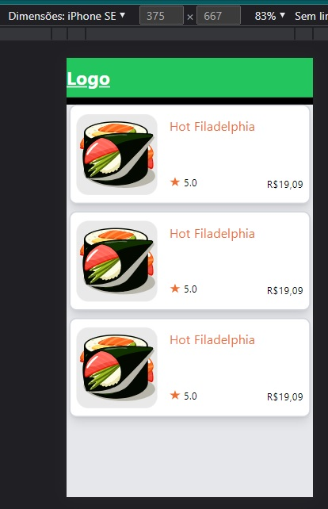

> **Projeto de estudo (N1).** Estado conferido em 18/11/2026: 10 de 10 critérios aplicáveis atendidos, com teste no navegador e axe no CI; MVP finalizado. Os alertas do Dependabot estão ligados, com 0 abertos em 18/11/2026. O site está no ar em https://douglasabnovato.github.io/sushibar/ (HTTP 200 em 18/11/2026). Detalhes em [docs/MVP.md](docs/MVP.md) e plano do ciclo em [docs/PLANO-DE-ACAO.md](docs/PLANO-DE-ACAO.md).

<h4 align="center">
	🍣 Sushibar 🚀
</h4>

<p align="center" style="display: flex; align-items: flex-start; justify-content: center;">
  
</p>

Site mobile-first de um restaurante japonês: destaques, cardápio por categoria com busca, bebidas e a página "Nosso espaço" com reserva pelo WhatsApp. Layout no [Figma](https://www.figma.com/file/UiLvyL3UxGZt15t0IDcP80/Sushibar?node-id=0%3A1&t=zffdeG1GjpNHWrwe-0).

## 🧠 O que aprendi

> Proposta de 01/11/2026, escrita a partir do código e das dependências. Ajuste com a sua experiência.

- Exportar um site estático com Next.js e Pages Router.
- Ler o cardápio no build, com Supabase opcional e reserva local.
- Tratar falha externa sem derrubar o build.
- Testar a montagem do cardápio com Vitest.

## Publicação

- No ar: https://douglasabnovato.github.io/sushibar/ responde 200 em 18/11/2026 (`curl -s -o /dev/null -w "%{http_code}"`). Publicado pelo job `deploy` do run [43928206341](https://github.com/douglasabnovato/sushibar/actions/runs/43928206341), na `main`, em 16/11/2026.
- Hospedagem: GitHub Pages (gratuito), com a fonte "GitHub Actions" (`gh api repos/douglasabnovato/sushibar/pages` → `build_type: workflow`, 18/11/2026). Publica a cada push na `main`, com a variável `PAGES_VIA_ACTIONS=true`.
- Passo a passo: [docs/DEPLOY.md](docs/DEPLOY.md)

## Estado e próximos passos (ciclo de 18/11/2026)

Site no ar: `douglasabnovato.github.io/sushibar/` responde 200 em 18/11/2026. A página 404 em português e os novos testes de teclado só chegam ao site depois do merge da sprint na `main`, que é do responsável.

**O que foi feito**
- Página 404 em português, com o menu e links para o cardápio e o início ([#26](https://github.com/douglasabnovato/sushibar/issues/26)); testes de teclado na página inicial, no Nosso espaço e no celular ([#28](https://github.com/douglasabnovato/sushibar/issues/28)). Na sprint, esperando a `main`.
- Teste no navegador (Playwright) do fluxo principal, com axe nas 5 páginas e teste de teclado, no job `e2e` do CI; link "Pular para o conteúdo" e foco visível; testes de falha do Supabase; 12 arquivos sem uso removidos; dependências de produção em patch e minor; publicação travada por variável até o Pages ser ligado ([#23](https://github.com/douglasabnovato/sushibar/pull/23)).
- `main` protegida pelo ruleset `principal-protegida` e workflow único com publicação no Pages só na `main` ([#20](https://github.com/douglasabnovato/sushibar/pull/20)).
- Busca no cardápio, setas nas abas e contraste corrigido no modo escuro do sistema ([#16](https://github.com/douglasabnovato/sushibar/pull/16)).
- Código antigo sem uso removido, incluindo `helpers/translator.ts` ([#7](https://github.com/douglasabnovato/sushibar/pull/7), [#16](https://github.com/douglasabnovato/sushibar/pull/16)).
- MVP de estudo registrado ([#8](https://github.com/douglasabnovato/sushibar/pull/8)).

**O que queremos fazer**
- [#10](https://github.com/douglasabnovato/sushibar/issues/10) Pages: ligado e publicado em 16/11/2026; fechar a issue é do responsável.
- [#24](https://github.com/douglasabnovato/sushibar/issues/24) Exigir o job `e2e` no ruleset da `main` (responsável).
- [#25](https://github.com/douglasabnovato/sushibar/issues/25) Alertas do Dependabot: ligados em 16/11/2026, com 0 abertos; a evidência está na issue, e fechá-la é do responsável.
- [#15](https://github.com/douglasabnovato/sushibar/issues/15) Decidir se cardápio e WhatsApp continuam ilustrativos (responsável).
- [#26](https://github.com/douglasabnovato/sushibar/issues/26) Página 404 em português com o menu: feita, esperando a `main`.
- [#28](https://github.com/douglasabnovato/sushibar/issues/28) Teclado na página inicial e no Nosso espaço: feito, esperando a `main`.
- [#27](https://github.com/douglasabnovato/sushibar/issues/27) Tailwind e TypeScript na versão maior.

**Onde está a documentação**
- Estado e critérios: [docs/MVP.md](docs/MVP.md).
- Plano do ciclo: [docs/PLANO-DE-ACAO.md](docs/PLANO-DE-ACAO.md), seção "Ciclo de 16/11/2026".
- Publicação: [docs/DEPLOY.md](docs/DEPLOY.md).
- Arquitetura e decisões: [docs/ARQUITETURA.md](docs/ARQUITETURA.md).

## Stack

Next.js 16 (Pages Router, exportação estática) · React 19 · Tailwind CSS 3 · Supabase (opcional)

## Como executar

Use o Node 22 com o npm 10, os mesmos da CI. Com outro npm, o `npm install` para com `EBADENGINE`: o `.npmrc` liga o `engine-strict`, para o lock ser sempre gerado pelo mesmo npm ([#44](https://github.com/douglasabnovato/sushibar/issues/44)).

```bash
npm install
npm run dev     # http://localhost:3000
npm test        # 15 testes (Vitest)
npm run build   # gera out/ (site estático publicado em /sushibar)
npx playwright install chromium   # uma vez, antes do teste no navegador
npm run test:e2e                  # 12 testes no navegador (Playwright + axe), servindo out/ em http://localhost:4317/sushibar/
```

## De onde vem o cardápio

- Sem configuração: `data/menu.ts` (itens e preços ilustrativos — edite com os reais).
- Com Supabase: copie `.env.example` para `.env.local` e preencha `NEXT_PUBLIC_SUPABASE_URL` e `NEXT_PUBLIC_SUPABASE_ANON_KEY`. Tabelas: `categories (id, title)` e `products (id, title, description, price, main_image, category_id, featured)`. O cardápio é lido no build: depois de alterar o Supabase, rode o workflow de novo (Actions → CI → Run workflow). Se o Supabase falhar no build, o site usa o cardápio local.
- WhatsApp de reservas e aviso de demonstração: `lib/site.ts`.

## Qualidade (18/11/2026)

| Medida | Resultado |
|---|---|
| `npm test` | 15 de 15 testes passam |
| `npm run test:e2e` | 12 de 12 passam: fluxo do cardápio, axe (WCAG A e AA) sem violações nas 5 páginas e na 404, teclado (cardápio, página inicial, Nosso espaço e celular de 375 px) e sistema em modo escuro (o app não tem tema escuro próprio: força o claro) |
| `npm audit --omit=dev` | 0 vulnerabilidades |
| Lighthouse | Não medido: em N1, o critério não se aplica |

Detalhes em [docs/MVP.md](docs/MVP.md), [docs/ANALISE.md](docs/ANALISE.md) e [docs/ARQUITETURA.md](docs/ARQUITETURA.md).

## Publicação gratuita

GitHub Pages: o site é exportado como HTML estático (`output: 'export'` em `next.config.js`) e publicado pelo workflow `.github/workflows/ci.yml` (job `deploy`, só na `main` e só com a variável `PAGES_VIA_ACTIONS=true`). O Pages está ligado desde 16/11/2026 (#10). Se usar Supabase, cadastre as duas variáveis em Settings → Secrets and variables → Actions → **Variables**. Se o nome do repositório mudar, ajuste `repoBasePath` em `next.config.js`. Passo a passo em [docs/DEPLOY.md](docs/DEPLOY.md).
