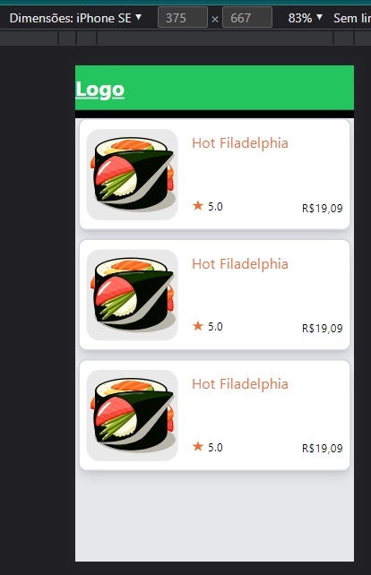

> **Projeto de estudo (N1).** Estado conferido em 03/11/2026: 9 de 10 critérios aplicáveis atendidos, MVP finalizado. O site ainda não está no ar (#10). Detalhes em [docs/MVP.md](docs/MVP.md) e plano do ciclo em [docs/PLANO-DE-ACAO.md](docs/PLANO-DE-ACAO.md).

<h4 align="center">
	🍣 Sushibar 🚀
</h4>

<p align="center" style="display: flex; align-items: flex-start; justify-content: center;">
  
</p>

Site mobile-first de um restaurante japonês: destaques, cardápio por categoria com busca, bebidas e a página "Nosso espaço" com reserva pelo WhatsApp. Layout no [Figma](https://www.figma.com/file/UiLvyL3UxGZt15t0IDcP80/Sushibar?node-id=0%3A1&t=zffdeG1GjpNHWrwe-0).

## 🧠 O que aprendi

> Proposta de 01/11/2026, escrita a partir do código e das dependências. Ajuste com a sua experiência.

- Exportar um site estático com Next.js e Pages Router.
- Ler o cardápio no build, com Supabase opcional e reserva local.
- Tratar falha externa sem derrubar o build.
- Testar a montagem do cardápio com Vitest.

## Publicação

- Fora do ar: https://douglasabnovato.github.io/sushibar/ dá 404 em 03/11/2026, porque o GitHub Pages não está ligado ([#10](https://github.com/douglasabnovato/sushibar/issues/10)). Para ver o projeto, rode localmente (seção "Como executar").
- Hospedagem prevista: GitHub Pages (gratuito), publicado pelo GitHub Actions a cada push na `main`
- Passo a passo: [docs/DEPLOY.md](docs/DEPLOY.md)

## Estado e próximos passos (ciclo de 03/11/2026)

Sem site publicado: o GitHub Pages não está ligado, e `douglasabnovato.github.io/sushibar/` dá 404 em 06/11/2026 ([#10](https://github.com/douglasabnovato/sushibar/issues/10)). Para ver o projeto, rode localmente.

**O que foi feito**
- Busca no cardápio e setas nas abas, com testes ([#16](https://github.com/douglasabnovato/sushibar/pull/16)).
- Contraste corrigido no modo escuro do sistema ([#16](https://github.com/douglasabnovato/sushibar/pull/16)).
- Régua N1 no `docs/MVP.md` e CI também na `developer` ([#16](https://github.com/douglasabnovato/sushibar/pull/16)).
- Código antigo sem uso removido, incluindo `helpers/translator.ts` ([#7](https://github.com/douglasabnovato/sushibar/pull/7), [#16](https://github.com/douglasabnovato/sushibar/pull/16)).
- MVP de estudo registrado ([#8](https://github.com/douglasabnovato/sushibar/pull/8)).

**O que queremos fazer**
- [#10](https://github.com/douglasabnovato/sushibar/issues/10) Publicar o site no GitHub Pages (responsável).
- [#11](https://github.com/douglasabnovato/sushibar/issues/11) Proteger a `main` exigindo CI verde (responsável).
- [#15](https://github.com/douglasabnovato/sushibar/issues/15) Decidir se cardápio e WhatsApp continuam ilustrativos (responsável).
- [#12](https://github.com/douglasabnovato/sushibar/issues/12) Etiquetas de dieta e alérgenos com filtro.
- [#13](https://github.com/douglasabnovato/sushibar/issues/13) Testes de interface do cardápio.
- [#14](https://github.com/douglasabnovato/sushibar/issues/14) Axe nas 5 páginas no CI.

**Onde está a documentação**
- Estado e critérios: [docs/MVP.md](docs/MVP.md).
- Plano do ciclo: [docs/PLANO-DE-ACAO.md](docs/PLANO-DE-ACAO.md), seção "Ciclo de 03/11/2026".

## Stack

Next.js 16 (Pages Router, exportação estática) · React 19 · Tailwind CSS 3 · Supabase (opcional)

## Como executar

```bash
npm install
npm run dev     # http://localhost:3000
npm test        # 12 testes (Vitest)
npm run build   # gera out/ (site estático publicado em /sushibar)
```

## De onde vem o cardápio

- Sem configuração: `data/menu.ts` (itens e preços ilustrativos — edite com os reais).
- Com Supabase: copie `.env.example` para `.env.local` e preencha `NEXT_PUBLIC_SUPABASE_URL` e `NEXT_PUBLIC_SUPABASE_ANON_KEY`. Tabelas: `categories (id, title)` e `products (id, title, description, price, main_image, category_id, featured)`. O cardápio é lido no build: depois de alterar o Supabase, rode o workflow de novo (Actions → CI → Run workflow). Se o Supabase falhar no build, o site usa o cardápio local.
- WhatsApp de reservas e aviso de demonstração: `lib/site.ts`.

## Qualidade (v1.0)

| Medida | Resultado |
|---|---|
| Lighthouse (mobile) | Desempenho 97 · Acessibilidade 100 · Boas práticas 96 · SEO 100 |
| axe-core (WCAG 2.2 AA) | 0 violações nas 5 páginas |
| `npm audit` | 0 vulnerabilidades |

Detalhes em [docs/ANALISE.md](docs/ANALISE.md), [docs/ARQUITETURA.md](docs/ARQUITETURA.md) e [docs/PLANO-DE-ACAO.md](docs/PLANO-DE-ACAO.md).

## Publicação gratuita

GitHub Pages: o site é exportado como HTML estático (`output: 'export'` em `next.config.js`) e publicado pelo workflow em `ci/github-actions-ci.yml`, que entra em `.github/workflows` quando o Pages for ligado (#10). Se usar Supabase, cadastre as duas variáveis em Settings → Secrets and variables → Actions → **Variables**. Se o nome do repositório mudar, ajuste `repoBasePath` em `next.config.js`. Passo a passo em [docs/DEPLOY.md](docs/DEPLOY.md).
